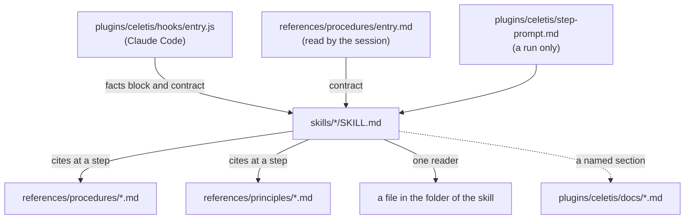

# About the skills and the agent text

A Celetis session is a coding agent that follows text. That text has a size, a home, and a time
when it loads. This document explains how the skills, the procedure modules, and the principles
steer an agent. It also explains why one copy of this text serves both Claude Code and Codex.

[About Celetis](overview.md) gives the whole product. [About the lifecycle of a
change](change-lifecycle.md) explains the lanes that the skills implement. [About the daemon and its
runs](daemon-and-runs.md) explains how a run starts a session that reads this text. [About the
records](records.md) explains the decision records that this document cites.

## The problem

The first design loaded a lot of text at each skill entry. A first entry on Claude Code loaded three
documents, and one of them two times, and most of that text was about host operations that the step
never reached. Inside
the skills, the same procedures appeared in several skills in different words: the lane start, the
worktree, the project context, the child dispatch, the landing, and the stop. The step text of a
run repeated the entry reads, so a session had to reconcile layers before it did the task
([ADR-0047](../adr/0047-skills-load-shared-procedures-on-demand.md), "Context" and "Constraints and
evidence").

The maintainer wanted one architecture for the skills and the text that they load. A change of one
procedure must be an edit of one file. A new skill must be its own steps plus citations of shared
text. The record names success as preserved behavior with less repeated procedure. The lower cost of
entry is a result, not the goal.

## The parts

Agent text has four layers. [`AGENTS.md`](../../AGENTS.md#where-agent-text-lives) holds the table of
the layers and the rules that place each piece of text. This section explains what each layer does.

The diagram shows what a skill loads and when. The next sections give the same facts in words.

### The entry

The entry is the first text of an invocation. It tells the session where the plugin is and what the
whole invocation must obey. Each `SKILL.md` holds one entry line, and that line sends the session to
the module `plugins/celetis/references/procedures/entry.md`. The module holds the contract of the
invocation: the paths, the command form, the issue writes, the rules for custom text, and a part for
each host.

On Claude Code, a native hook makes the entry. The hook is `plugins/celetis/hooks/entry.js`, built
from `engine/hooks/entry.ts`. It reads the checkout and `.celetis.yaml` with the permission-checked
`Read` of the host, and it puts a block in place of the entry line. The block holds the facts, the
contract, and the custom text. On Codex, no hook exists, so the session reads `entry.md` itself. When
the hook does not run on Claude Code, the session takes the same path as Codex
([ADR-0047](../adr/0047-skills-load-shared-procedures-on-demand.md), "Decision", "Entry is a facts
block").

### The skill

A skill is a `SKILL.md` file in `plugins/celetis/skills/<name>/`. It holds the steps that only this
skill needs. It does not copy a shared procedure. At the step that needs one, it cites a module by
path. The `bug` skill, for example, cites `lane-start.md`, `worktree.md`,
`diagnosis.md`, and `prior-art.md` at the steps that use them.

A skill never names a host tool. A skill also never reads the `SKILL.md` of another skill.

### The procedure module

A procedure module is text that two or more skills, or a skill and the step text, need. It lives in
`plugins/celetis/references/procedures/`. A session reads a module whole, in one read, when a step
names it, and not before. A module holds the procedure that is the same on each host. Then it holds a
short `Claude Code` part and a short `Codex` part. The module `worktree.md` shows the form: the entry,
the conflict, and the removal are host-neutral, and the two host parts say which tool enters the
worktree.

The target size is under 100 lines. A longer module starts with a `## Contents` list. A module cites
another module only for a branch that some runs take, so the reads stay one level deep.

### The principle

A principle is a general engineering rule, for example `make-operations-idempotent`. It has one
canonical file in `plugins/celetis/references/principles/`, with the sections `Applies when`, `Rule`,
and `Check`. It holds no workflow and no host procedure. A skill that is named for the principle
reads the file and applies it to the task. A lane skill cites the same file at the step where the rule
can apply. For example, `plan` lists the principles and puts the path of each applicable one into the
task text, not a copy of the rule.

The home of a principle does not depend on how many callers it has. A rule kept only inside a lane
cannot serve an ordinary task, and copies in several callers can diverge
([ADR-0050](../adr/0050-standalone-engineering-principles-have-canonical-rules.md), "Context"). No
entry scan loads the principles as a group, because that would add rules that do not apply to the
task.

### The step text of a run

A step session that the daemon starts adds two more texts. The session of `specify` is the one
session with no step text ([the workflow document](../../plugins/celetis/docs/workflow.md), "The
session of `specify`"). The daemon puts a facts header before the step text: the issue, the step,
the host, the main checkout, the plugin root, and the landing mechanism. Claude gets the text
through `--append-system-prompt`, and Codex through `developer_instructions`.
`plugins/celetis/step-prompt.md` holds only what differs in a step session. It overrides no skill
([ADR-0047](../adr/0047-skills-load-shared-procedures-on-demand.md), "Decision", "A runner step gets
a facts header").

### The documents for people

`plugins/celetis/docs/` holds documents that people read. An agent does not read them at entry. A
skill or a module cites a named section of one only when a step needs a definition.

## Why this shape

### Load on demand

The shape follows a pattern that other agent tools use. The Agent Skills specification has three
tiers of progressive disclosure, and the Claude Code documentation says that a skill names its
supporting files and that Claude reads them only when needed
([ADR-0047](../adr/0047-skills-load-shared-procedures-on-demand.md), "Constraints and evidence").
So the entry is a small facts block, and a module loads when its step comes.

The project considered two other ways to share text. In the first, each operation has a host-neutral
module plus one file for each host. Only the text of the selected host would load. The record rejects
it: it needs two reads for each operation, two or three files to edit for each change, and a chain of
references two levels deep. In the second, the hook inlines the modules when the skill expands. The
record rejects it because it loads eagerly on Claude Code, it keeps two delivery paths in step, and
it puts the logic of the architecture inside the hook. The chosen way accepts a small cost: the lines
of the other host load too, about 3 to 6 lines for each module
([ADR-0047](../adr/0047-skills-load-shared-procedures-on-demand.md), "Decision" and "Alternatives
considered").

### One copy for both hosts

One set of skills, one step text, and the shared procedures serve both hosts
([ADR-0047](../adr/0047-skills-load-shared-procedures-on-demand.md), "Supersedes"). Three decisions
make this work.

1. **Host text lives in one place.** Host-specific text lives only in modules, under a `Claude Code`
   and a `Codex` part. Skills and principles never name a host tool. The entry block of the hook is
   the exception ([`AGENTS.md`](../../AGENTS.md), "Where agent text lives").
2. **The entry differs in delivery, not in content.** Claude Code gets the contract from the hook.
   Codex reads the same `entry.md`. Both sessions follow the same contract text.
3. **The commands are the same program.** Each command has the form `celetis --agent <host>
   <command>`. One installed program runs it for both hosts. The user asked for "a single celetis on
   path to work under claude/codex" and the plugins give the skills, the hook, and the documents
   that skills cite ([ADR-0042](../adr/0042-one-celetis-program-for-both-hosts.md), "Context" and
   "Decision").

The entry contract also has an `OpenCode` part. The workflow runs only the step triage on OpenCode
(see [the workflow document](../../plugins/celetis/docs/workflow.md)).

### Custom text and product facts

A product project can add text to one skill. It sets `custom.<skill>` in `.celetis.yaml`, and the entry
loads that string for that invocation only. The custom text cannot remove a rule of the skill. A
product fact that two or more skills need goes into the `AGENTS.md` of the product. The daemon does
not supply custom text, because the permission-checked read of the host does that, and a lane entry
must read the file of its own lane ([ADR-0047](../adr/0047-skills-load-shared-procedures-on-demand.md),
"Alternatives considered").

### The folders

The folders of `plugins/celetis/` say what each file is. At one time, `plugins/celetis/docs/` held 46
files, and 41 of them were not documents for people. The folder name did not say what they were
([ADR-0095](../adr/0095-the-shared-agent-text-lives-in-references.md), "Context"). The layout rule
now has three parts:

- `references/` holds agent text that more than one caller can load: the modules and the principles.
- A file that only one skill reads lives in the folder of that skill. The guide and the template of
  the skill `record-architecture-decisions` are an example.
- `docs/` holds only documents that people read.

The record considered a separate folder for each layer at the plugin root, a folder of each skill
for everything that skill reads, and a folder with no skill inside `skills/`. It chose one
`references/` folder. A shared file cannot live in the folder of one skill, because no skill reads
the `SKILL.md` of another skill, and a module has two or more callers. The hosts give the folder no meaning, and the Claude Code plugin check passes
with it ([ADR-0095](../adr/0095-the-shared-agent-text-lives-in-references.md), "Constraints and
evidence" and "Alternatives considered").

## How the project keeps the text sound

The verify gate checks the references between these files. `checkCitations` in `scripts/verify.ts`
checks that each citation and each relative link names a tracked file, that each module has two or
more citers, that each `SKILL.md` holds the entry line once, and that no skill, module, or principle
cites a host document. The gate checks the references, not the behavior. It does not prove that a
session reads a module whole or applies a rule. Those facts need separate evidence
([ADR-0047](../adr/0047-skills-load-shared-procedures-on-demand.md), "Consequences";
[ADR-0050](../adr/0050-standalone-engineering-principles-have-canonical-rules.md), "Consequences").

The text of this repository is also general. It names a role, such as "the verify gate of the
project", and never a part of one product. See the section "General text" of
[`AGENTS.md`](../../AGENTS.md) for the rule.

## Related reading

- [`AGENTS.md`](../../AGENTS.md#where-agent-text-lives): the layers and the placement rules.
- `plugins/celetis/references/procedures/entry.md`: the entry and the contract, as the session reads
  them.
- [The plugin README](../../plugins/celetis/README.md#the-skills): the table of the skills.
- [ADR-0047](../adr/0047-skills-load-shared-procedures-on-demand.md),
  [ADR-0050](../adr/0050-standalone-engineering-principles-have-canonical-rules.md), and
  [ADR-0095](../adr/0095-the-shared-agent-text-lives-in-references.md): the decisions behind this
  design.
