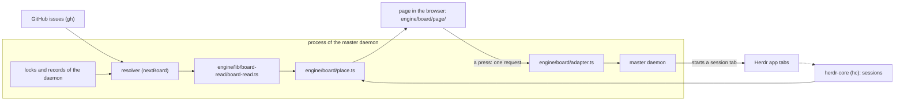

# About the board

The board is a local web page for one git repository. It shows each live agent session and each
issue of the flow. It also starts a step of an issue with one press. This document explains what
the board shows, where the data comes from, and why no card moves by hand. It also tells how the
board came to be a part of the daemon.

[The board document](../../engine/board/README.md) is the reference: it gives each rule, key, and
text. [About Celetis](overview.md) gives the context of the whole product.

## What the board shows

A person who runs Celetis on a repository keeps the board open all day, beside the Herdr app tabs
where the agent sessions run ([PRODUCT.md](../../PRODUCT.md)). The product principle is: show what
needs the human first, and never leave an agent that waits unseen
([PRODUCT.md](../../PRODUCT.md)).

The board has two kinds of card:

- A **session card** shows a live agent session. The session is a terminal of herdr-core (`hc`)
  whose host reports a status. The host is Claude Code, Codex, or OpenCode.
- An **issue card** shows an issue that has no session now. The card names the next step of the
  issue, or the reason why the issue cannot go on.

The page puts each card in one of three columns: Needs you, Running, and Idle. A session with no
issue is a human session, which a person started. It has no column and shows in a strip above them.
The state of a session wins over the state of its issue, so an issue with a session has no issue card.

The page has more views of the same data. Pipeline shows each issue at its step, in one column for
each stage of the workflow. Queue shows the continuous queue. History shows the issues that landed
on the trunk. Home lists what needs you and the agents that work now. Control holds the agent order,
the update control, and the status of the reads
([The cards](../../engine/board/README.md#the-cards) and
[The layout, the keys, and the errors](../../engine/board/README.md#the-layout-the-keys-and-the-errors)
give the details).

## Where the data comes from

The board holds nothing of one repository ([PRODUCT.md](../../PRODUCT.md)). Its two inputs come from outside the page:

- **The sessions** come from herdr-core (`hc`), which keeps the terminals in which the agents run.
  The Herdr app shows these terminals as tabs.
- **The issues** come from one typed document. The board builds it in the process of the daemon,
  with the resolver and the locks of the engine. The resolver reads GitHub through `gh`.

The lanes, the steps, the stages, and the tracker name come from that document. The page holds no
list of them. A session links to an issue through the link label `celetis.link`, for example
`#<n> <step>`, which the daemon sets on each session tab
([The data](../../engine/board/README.md#the-data) and
[The cards](../../engine/board/README.md#the-cards)).

The diagram shows the loop. A press goes to the daemon. The daemon starts a session. The session
shows in `hc`. The next read puts a card for that session in the page. No card moves by hand
([the board document](../../engine/board/README.md)).

The code of the board is in `engine/board/`, and the read model is in `engine/lib/board-read/`. The
full list of fields and of the rules of each state is in
[The data](../../engine/board/README.md#the-data).

## Why no card moves by hand

The product states it as a rule: the workflow and the daemon place each card, and the board starts no step by itself
([PRODUCT.md](../../PRODUCT.md)). ADR-0003 already states that no
card moves by hand ([ADR-0003](../adr/0003-a-local-web-board-starts-each-step-in-herdr.md)).

The product gives the reason in two principles. The board reflects the flow, and it does not own
it: the issue and the daemon stay the authority ([PRODUCT.md](../../PRODUCT.md)). And the GitHub
issue is the single state store: no step keeps state that the next step cannot read from the issue
([PRODUCT.md](../../PRODUCT.md), "Positioning").

The design of the board follows this rule in three ways:

- **A card is a result.** The column of a card follows from the status of a session, or from the
  state that the resolver gives to an issue. ADR-0003 gives the rules for the
  columns one home, the function `place`, and says that the server holds none of the rules of the
  gate, the lock, and the record ([ADR-0003](../adr/0003-a-local-web-board-starts-each-step-in-herdr.md)).
  In the engine, `engine/board/place.ts` places the cards
  ([ADR-0087](../adr/0087-the-board-reads-engine-state-through-one-read-model.md)).
- **There is one definition of the workflow.** The board and the daemon use the same workflow
  definition, the same resolver, and the same lock module. A change of the document is a change of
  a type that the compiler checks. It is not a new contract version
  ([ADR-0035](../adr/0035-the-board-is-a-part-of-the-engine.md)). ADR-0035 names the daemon "the
  runner". [ADR-0075](../adr/0075-the-names-of-the-workflow-the-daemon-and-a-run.md) renamed the
  old runner. So the board has no second state model.
- **A press is a request, not a move.** Run, Resume, Stop, and Set aside each send one request to
  the daemon, with fixed fields. During a Run or Resume press, the card shows `Starting` while the
  request runs, and the next read puts the card where its state belongs. A press that fails ends
  `Starting` and gives the cause
  ([The commands of the board](../../engine/board/README.md#the-commands-of-the-board)).

The board also does not start a step on its own. Each step of a lane has a gate. A `manual` gate means that a
person starts the step. The person presses Run, adds the issue to an empty queue, or continues the
queue. An `auto` gate means that auto mode of the daemon starts the step. The board only shows
`auto` or `auto off` on such a card. The daemon decides, and the board mirrors it ([The
gates](../../plugins/celetis/docs/workflow.md#gates)).

A person still gives orders to the board. The person sets the agent order in Control, and
presses Run, Resume, Stop, and Set aside on cards. These presses go to the daemon as requests. They
change the work, and the next read changes the cards. The agent order goes through the fixed
adapter, which runs `agents replace`
([the board document](../../engine/board/README.md#the-commands-of-the-board)).

Two product principles back this design. The board never hides the state: when a read fails, the
last good read stays on the screen, with the cause. And each press does one thing: it says what
happened, and a failed press names its cause ([PRODUCT.md](../../PRODUCT.md)).

## Where the board lives, and why

The board has had five homes. The record of each move names its reason.

1. **A page of the product repository.** ADR-0003 chose a local web page over a pane of the Claude
   Code mod. The maintainer chose the web page "to be more pretty". The page started each step in a
   tab of the herdr terminal program
   ([ADR-0003](../adr/0003-a-local-web-board-starts-each-step-in-herdr.md)).
2. **A package of its own.** ADR-0009 moved the board out of the product repository into the
   package of another repository, with a contract that has a version as its input
   ([ADR-0009](../adr/0009-the-board-is-a-package-of-its-own.md)).
3. **A part of the plugin.** The board was a private package that each start fetched with `npx`.
   That needed the network and git credentials at each start. A pin of its version stood in nine
   files, so a change across the boundary needed two issue trackers. CI could not read the private
   repository, so no CI run checked the board against its producer. ADR-0020 moved the board into
   the plugin, and no repository used the board without Celetis
   ([ADR-0020](../adr/0020-the-board-is-a-part-of-the-plugin.md)).
4. **A part of the engine.** The board still received command lists and ran a data command as a
   subprocess, checked against a JSON contract. ADR-0035 removed that layer. The board now reads its
   data in its own process with the typed resolver. It starts only fixed commands. The record
   rejected two other ways: to export the document builder from the runner, which mixes the runner
   and the board in one module, and to keep the data subprocess, which keeps a JSON contract for one
   producer ([ADR-0035](../adr/0035-the-board-is-a-part-of-the-engine.md)). A consequence is that
   the board knows Celetis: a second tracker needs a new data module and a new adapter.
5. **A part of the master daemon.** The board was still a process of its own, next to the daemon.
   An approved update restarted only the board, so the daemon kept the old program. ADR-0077 made the
   daemon host the board. One process of the repository now serves the board, the update check, and
   every run ([ADR-0077](../adr/0077-the-master-daemon-hosts-the-board-and-restarts-as-a-successor.md)).
   With no daemon, nothing serves the board
   ([Start](../../engine/board/README.md#start)).

Later records replace parts of ADR-0020 and ADR-0035. The current facts are in [the board
document](../../engine/board/README.md). The board is the folder `engine/board/` of the engine. The
master daemon serves it in its own process. It is Bun code with no dependency of its own.

The sessions have a separate history. Before ADR-0058, the terminal program herdr gave the state of
each session. ADR-0058 moved the sessions to herdr-core. The state of a session is now what the host
reports (the status OSC 7501), never the screen or the title of the window. The Herdr app gives the
tabs ([ADR-0058](../adr/0058-herdr-core-hosts-the-agent-terminals.md)).

## Why the board trusts little

A Run press starts an agent session, so the trust boundary of the server is part of the design
([ADR-0003](../adr/0003-a-local-web-board-starts-each-step-in-herdr.md)). The server listens on `127.0.0.1` only. It refuses a request with the
wrong `Host`, and it refuses a POST from another origin. ADR-0003 gives the reason: a page of
another site then cannot start a step ([ADR-0003](../adr/0003-a-local-web-board-starts-each-step-in-herdr.md)).
The page sends an issue key, a session id, or a fixed field, and never a command. The server
starts `hc`, `herdr-app`, `git`, and `gh` with no shell
([The trust boundary](../../engine/board/README.md#the-trust-boundary)).

One feature needed an extra rule. A person can ask for a visual page of a landed change from a row
of History. A model writes that page as HTML, and the board origin holds the POST endpoints of the
presses. So the board serves the page at `/visual/<sha>` with a sandbox that gives it an opaque
origin. Its cross-origin requests and its POSTs carry `Origin: null` and get 403. The record chose
this route over an opener program of the OS, over a hidden headless run, and over a sandbox that
keeps the board origin, which could press Run
([ADR-0065](../adr/0065-the-board-serves-each-visual-page-in-a-sandbox.md)).

## Related documents

- [About Celetis](overview.md): the whole product and where the board fits.
- [About the lifecycle of a change](change-lifecycle.md): the lanes, the steps, and the gates that
  the board shows.
- [About the daemon and its runs](daemon-and-runs.md): the process that serves the board and starts
  each session.
- [About the records](records.md): the ADRs that this document cites.
- [The board document](../../engine/board/README.md): the reference for the board.
