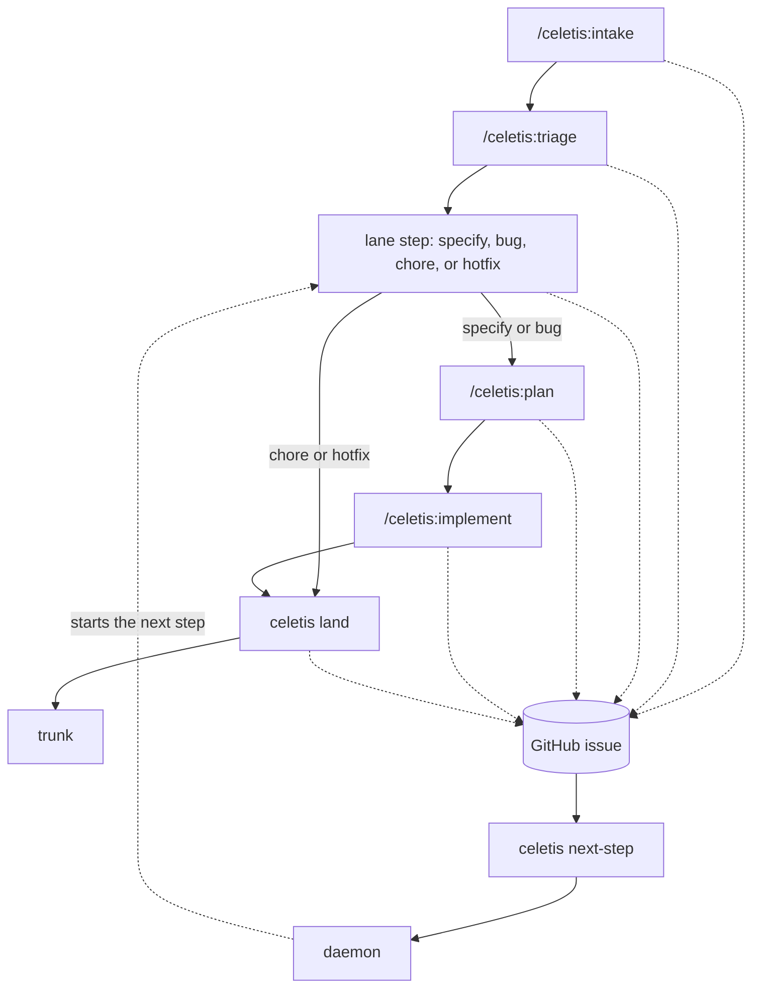

# About the lifecycle of a change

This document explains how a request becomes a change on the trunk, and why the GitHub issue holds
the state of that change. It gives the shape of the path and the reasons behind it. It is not a
step list: [The full loop](../../plugins/celetis/README.md#the-full-loop) of the plugin README gives
the commands, and [The Celetis workflow](../../plugins/celetis/docs/workflow.md) gives what a
person and a session meet at each step.

[About Celetis](overview.md) gives the whole product. This document covers one topic of it: the
life of one change, from a request to the trunk.

## The path of a change

A request starts as free text. `/celetis:intake` writes it as an intent and puts it on a new issue
with the label `needs-triage`. `/celetis:ideate` also puts intents on new issues: the maintainer
picks ideas from a grounded list, and each picked idea gets its own issue with the same label.
`/celetis:triage` then picks a lane for the issue. A lane is a type
of change with its own ordered steps: `feature`, `bug`, `chore`, or `hotfix`. The lanes, with their
labels, branch prefixes, and steps, are the `lanes` table of `engine/lib/workflow/workflow.ts`.
The table holds only the own steps of each lane.

The order is intake, then `triage`, then the lane with its own steps. Intake and `triage` come
before the lanes, and neither is a step of a lane. The `feature` lane runs `specify`, `plan`, and
`implement`. The `bug` lane finds the root cause first, and then hands on to `plan`. The `chore`
and `hotfix` lanes have one step. Each of them verifies, commits, and lands in one session
([The full loop](../../plugins/celetis/README.md#the-full-loop),
`plugins/celetis/skills/hotfix/SKILL.md`).

The landing is the last act of the lane steps. A `hotfix` session ends with a checklist of the ship
acts of the project. The maintainer does them after the landing
(`plugins/celetis/skills/hotfix/SKILL.md`). `celetis land`
puts the change on the trunk and closes the issue. The `landing` field of `.celetis.yaml` chooses
how: `pr` merges a pull request, and `merge`
puts one squash commit on the trunk with no pull request.

The diagram shows each lane. A dotted line is a read or a write of the issue. The solid
lines from the issue go to the resolver, which tells the daemon the next step to start. A chore or
a hotfix goes from its lane step straight to the landing.

A person can walk this path in sessions by hand, or the daemon can walk it. The daemon asks the
resolver for the next step of an issue, starts that step in a new session, and ends the session
when the issue shows that the step is done. A gate of each lane and step decides who starts the
step: `manual` waits
for a person, and `auto` lets the daemon continue by itself
([Gates](../../plugins/celetis/docs/workflow.md#gates)).
[About the daemon and its runs](daemon-and-runs.md) explains the daemon.

## The issue is the state store

`plan` and `implement` each start in a fresh context, and each one reads the issue again
([The full loop](../../plugins/celetis/README.md#the-full-loop)). So such a step cannot depend on
what an earlier session said in a chat. The issue carries the state: it lives in the issue and the
repository, never in chat history
([Issue tracker](../../plugins/celetis/docs/issue-tracker.md)). No step keeps state that the next
step cannot read from the issue (`PRODUCT.md`, "Positioning").

[What lives on the issue](../../plugins/celetis/docs/issue-tracker.md#what-lives-on-the-issue) lists
each record. For example, the approved design becomes the body of the issue, the plan is a comment
that starts with `## Plan`, and a comment that starts with `## Built` records that the build is
complete. The labels mark the lane and the waits.

This choice is old. An early record of the runner already says that the flow keeps its shape: the
issue is the state store, a resolver finds the next step, and each step gets a fresh context
([ADR-0002](../adr/0002-loop-script-and-mod-run-the-agent-flow.md)). Later records keep it. A
rejected design for the board shows why the store is not a task board of another product: a GitHub
Projects board shows issues only, and a ready-made agent board brings its own task store and its
own runner ([ADR-0003](../adr/0003-a-local-web-board-starts-each-step-in-herdr.md)).

Two other stores were considered and rejected:

- **A local workflow database.** The issue that asked for the lifecycle rules excluded it, and
  excluded any local state store
  ([ADR-0036](../adr/0036-the-engine-enforces-the-lifecycle-and-the-landing.md)).
- **Progress stored locally.** This would split the durable state and break the hand-offs through
  the issue ([ADR-0045](../adr/0045-readiness-is-separate-from-build-completion.md)).

## How the engine reads the issue

One part of the engine decides the next step, and each other part asks it. `decide` in
`engine/lib/workflow/workflow.ts` is a pure function. It takes the data of one issue and returns a
typed decision: a Run of a step, or a Stop with a reason
([ADR-0033](../adr/0033-one-workflow-definition-and-the-skip-rule.md)).
The GitHub adapter of the tracker port (`engine/lib/github/tracker.ts`) reads the issue and its timeline from GitHub,
and `factsOf` computes the facts from that history. The resolver (`celetis next-step`), the daemon,
the board, `land`, and the `issue` command all call the same functions
([ADR-0036](../adr/0036-the-engine-enforces-the-lifecycle-and-the-landing.md)). ADR-0036 names the
daemon "the runner". [ADR-0075](../adr/0075-the-names-of-the-workflow-the-daemon-and-a-run.md)
renamed the old runner.

There was a reason to make this one definition. Before it, several parts kept their own copy of
the lane labels and the step names. For an issue with two lane labels, the copies disagreed: the
resolver took one lane, the board took another, and `worktree` refused the issue
([ADR-0033](../adr/0033-one-workflow-definition-and-the-skip-rule.md)). Now an issue with two lane
labels gets one result: the resolver stops until a person keeps one lane label.

[Resolving an issue's state](../../plugins/celetis/docs/issue-tracker.md#resolving-an-issues-state)
gives the states and the order of the rules.

### Order comes from the timeline, not from the clock

Some rules compare two events of the issue, for example a `## Plan` comment and a later comment.
The engine reads "after" as a later position in the timeline. It never compares the times of the
two events. GitHub does not document the order of two entries with the same time, and one engine
act can write two entries in the same second
([ADR-0036](../adr/0036-the-engine-enforces-the-lifecycle-and-the-landing.md), "The position
rule").

### A label is never evidence

An early version read the labels and the first line of each comment. A label that a failed write did
not add then read as "done"
([ADR-0036](../adr/0036-the-engine-enforces-the-lifecycle-and-the-landing.md), "Context"). The
engine now records completion in comments. A plan with no `## Built` comment and no `## Before
landing` comment stays unfinished, whatever the labels say. The labels `ready-for-agent` and
`ready-for-human` show only the current readiness, so a stop can show one readiness value and keep
the build progress ([ADR-0045](../adr/0045-readiness-is-separate-from-build-completion.md)). The
same holds for a human hold: the absence of `ready-for-human` is no proof that a person did the act
([Completing a human
precondition](../../plugins/celetis/docs/issue-tracker.md#completing-a-human-precondition)).

The project considered a separate build label, and chose comments instead: a label adds a protocol,
and the timeline can already hold an explicit completion record
([ADR-0045](../adr/0045-readiness-is-separate-from-build-completion.md)).

### The writes have one door

The command `celetis issue` owns each workflow write that the engine reads. Each act checks its
prerequisite with the same facts before it writes, and it writes the heading of the comment itself.
So the skills do not write lifecycle headings. An act posts the comment first, then the labels. If a
write after the first one fails, the issue stays in a state that the rules read as safe, and the
command names the repair
([ADR-0036](../adr/0036-the-engine-enforces-the-lifecycle-and-the-landing.md),
[Conventions](../../plugins/celetis/docs/issue-tracker.md#conventions)).

## What the engine enforces

Earlier, the rules that protect a landing were prompt text only. No code checked them. The maintainer
named three risks: a precondition comment whose label write fails, and the next run lands; a suite
that passes, and then one more changed line lands; and a re-entry that builds a built change again
([ADR-0036](../adr/0036-the-engine-enforces-the-lifecycle-and-the-landing.md), "Context"). The
maintainer chose one set of rules in the engine that each caller uses
([ADR-0036](../adr/0036-the-engine-enforces-the-lifecycle-and-the-landing.md), "Decision"). The
step text carries the rule of the holds
([ADR-0011](../adr/0011-a-step-session-hands-a-stop-to-the-issue.md)). The three parts below are
the order of the steps, the holds, and the landing.

**The order of the steps.** A lane runs its steps in order. After a session ends, the daemon reads
the next decision. A run refuses a step that skips a step of the lane. A start by number is the
override: it runs the step that the maintainer asks for
([ADR-0033](../adr/0033-one-workflow-definition-and-the-skip-rule.md)). A `bug` session also writes
the plan, so the skip rule measures from the position of `plan` for a `bug` session
([ADR-0038](../adr/0038-a-bug-session-hands-on-to-plan.md)).

**The holds.** A step session that cannot go on hands a stop to the issue: a comment, then the label
`ready-for-human`. The resolver stops the issue, and no step starts until a person acts
([ADR-0011](../adr/0011-a-step-session-hands-a-stop-to-the-issue.md),
[A stop](../../plugins/celetis/docs/workflow.md#a-stop)).

**The landing.** The script decides the landing, not the session. Before each push, pull request,
check re-run, and merge, `land` reads the issue again and refuses unless the issue is ready to land.
With the landing `merge`, `land` runs the `suite` file of the project at the exact tip that it
lands
([ADR-0036](../adr/0036-the-engine-enforces-the-lifecycle-and-the-landing.md)). The build step
itself calls `land`, so one session builds and lands the change and keeps the context of the build.
The older design had a second session for the merge. That session had none of the context, and
nothing fixed a refused merge ([ADR-0008](../adr/0008-the-build-step-lands-the-change.md)).
[Branches, PRs, merge](../../plugins/celetis/docs/issue-tracker.md#branches-prs-merge) and
[A landing](../../plugins/celetis/docs/workflow.md#a-landing) give the exit classes and the
prerequisites.

## Other designs that the project rejected

- **Each command checks its own rules.** The change is smaller, but the rules then exist more than
  once and drift apart ([ADR-0036](../adr/0036-the-engine-enforces-the-lifecycle-and-the-landing.md)).
- **The labels are the only truth.** A failed label write then reads as "done"
  ([ADR-0036](../adr/0036-the-engine-enforces-the-lifecycle-and-the-landing.md)).
- **An explicit state-machine table of allowed transitions.** It writes the lane order a second
  time, and nothing checks that the two agree. The tracker also gives no events that a state machine
  can use: the resolver reads a snapshot of the issue
  ([ADR-0033](../adr/0033-one-workflow-definition-and-the-skip-rule.md)).
- **No suite guard, or a suite record that the agent makes.** The agent would then pick the command
  that runs, and the record still needs a binding to the commit
  ([ADR-0036](../adr/0036-the-engine-enforces-the-lifecycle-and-the-landing.md)).

## What would change this

The records name the conditions. The design is open to review when GitHub stops being the state
store, when the tracker gives events that a state machine can use, or when GitHub documents an order
for timeline entries of the same second
([ADR-0036](../adr/0036-the-engine-enforces-the-lifecycle-and-the-landing.md),
[ADR-0033](../adr/0033-one-workflow-definition-and-the-skip-rule.md)).

When the engine cannot read the issue from GitHub, the resolver gives a stop, and the session
stays open
([The step end](../../plugins/celetis/docs/workflow.md#the-step-end)).

## Related documents

- [About Celetis](overview.md): the product and its parts.
- [About the skills and the agent text](agent-text.md): the skills that run each step.
- [About the daemon and its runs](daemon-and-runs.md): how the daemon starts and ends the sessions.
- [About the board](board.md): how the board shows each issue and its next step.
- [About the records](records.md): the decision records that this document cites.
