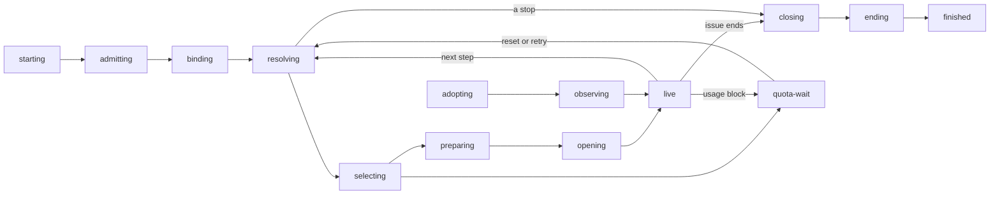

# About the daemon and its runs

The daemon is the one process that drives the work of a repository. This document explains what the
daemon does, how a run moves from step to step, and what auto mode changes. It does not list the
commands, the requests, or the records: [the engine document](../../engine/README.md) holds them.
[About Celetis](overview.md) shows where the daemon sits in the whole product.

## Why one daemon

Before the daemon, each start was its own process. A numbered start, auto mode, a queue wake, and a
resume each ran in a separate process. No process knew all the work of a repository. When one of
those processes stopped, its working sessions had no steering, and no later process took them over.
The maintainer wanted one owner of the whole cycle
([ADR-0072](../adr/0072-one-master-daemon-runs-every-issue-run.md), "Context").

So one daemon runs for each repository. The daemon belongs to the Git common folder, so a linked
worktree reaches the daemon of its main checkout. Nothing starts a daemon by itself: the maintainer
runs `celetis daemon start`. The daemon runs many issue runs at the same time, in one process. Each
request makes one run, with its own lock owner, and the issue locks keep one owner for each issue
([ADR-0072](../adr/0072-one-master-daemon-runs-every-issue-run.md), "Decision").

The project considered other forms and did not pick them. A file inbox gives no direct answer and
needs a poll for each reply. A daemon in a hidden terminal depends on the hc server and needs the
trust checks of a TCP port. A restart with no takeover loses the steering of a working session
([ADR-0072](../adr/0072-one-master-daemon-runs-every-issue-run.md), "Alternatives considered").

## What the daemon does

The daemon has four jobs:

- It runs the issue runs. The run engine is `engine/lib/run/engine.ts`.
- It runs each landing, one at a time. The command `celetis land` is a client: it sends one request
  and prints what the daemon writes back
  ([A landing](../../plugins/celetis/docs/workflow.md#a-landing)).
- It serves the board, the local web page of the repository
  ([About the board](board.md)).
- It answers requests over HTTP on a Unix socket in a private folder of the user. The commands
  `run`, `queue`, and `land` are its clients, and the board gives its presses to the same
  dispatcher inside the daemon process
  ([The master daemon](../../engine/README.md#the-master-daemon), "The requests").

The daemon takes its environment from the shell of `celetis daemon start`. A later change of that
environment does not reach a running daemon or its runs. A client sends only its host selection, its
model, and its effort level with a request
([The start of a step](../../engine/README.md#the-start-of-a-step)).

The daemon does not hold the sessions. A session lives in a tab of the Herdr app, outside the daemon
process ([The session tab](../../engine/README.md#the-session-tab)). The daemon steers the tab from
outside. When the daemon stops, it detaches each run and keeps the released sessions open in their
tabs. A later daemon adopts the runs and the live sessions again, through the lock owner records
([ADR-0072](../adr/0072-one-master-daemon-runs-every-issue-run.md), "Decision";
[The master daemon](../../engine/README.md#the-master-daemon), "The takeover"). Between the stop and the takeover, no
daemon steers the sessions, so a session that ends its step in that gap waits until the new daemon
takes over its run.

The names follow one rule: each name tells what the part does. The daemon owns every run of a
repository. A run is the work of one issue. The word "runner" is not used, because in GitHub and
GitLab a runner is a worker machine that executes a job, and that is not what the daemon is
([ADR-0075](../adr/0075-the-names-of-the-workflow-the-daemon-and-a-run.md), "Alternatives
considered").

## How a run moves from step to step

A run does not know the next step in advance. The resolver decides it. The resolver is the function
`nextIssue` of `engine/lib/resolver/resolver.ts`, and it reads the issue on GitHub. Its decision is
either a Run of one step or a stop. The workflow itself, with its lanes, steps, and skip rule, is
one definition in `engine/lib/workflow/workflow.ts`. The text of a lane and its steps is in
[About the lifecycle of a change](change-lifecycle.md).

The path of one step is:

1. The daemon reads the decision of the issue from the resolver.
2. It opens a session of the selected host in a new tab and starts the step in it
   ([How a step runs](../../plugins/celetis/docs/workflow.md#how-a-step-runs)).
3. The session does the step and writes each result to the issue. The issue stays the state store.
4. The daemon watches the tab. When the host is idle and the resolver gives a different result than
   the one that started the session, the daemon ends the session
   ([The step end](../../plugins/celetis/docs/workflow.md#the-step-end)). The exit status of the
   host decides nothing: the resolver decides.
5. The daemon reads the decision again. When the next step has the gate `auto`, it starts that step.
   Otherwise the run ends.

A start with one number, `celetis run <n>`, shows the rule. The daemon starts the first step
whatever its gate is. After each session, it starts a next step only when its gate is `auto`. The
run ends at the first of these: a stop, the same step again (no progress), a refused skip, or a
`manual` gate. A refused skip is a next step that jumps over a step of its lane. With the default
gates, every step is `manual`, so one start runs one step
([The start of a step](../../engine/README.md#the-start-of-a-step)).

When a usage limit stops a step, the run waits in its own state and the daemon can continue the step
on another host. [Usage-limit recovery](../../engine/README.md#usage-limit-recovery) gives the
rules.

### The run as a state machine

A run is an explicit state machine. Before this form, the states of a run were positions in one
closure of about 1,500 lines. A reader could not list the states, the events, or the transitions,
and the type check could not find a missing one. The decision
([ADR-0103](../adr/0103-a-run-of-the-daemon-is-an-explicit-state-machine.md)) made each state, event,
and transition a named value.

The machine has three parts. Each is one file of `engine/lib/run/`:

| File | Role |
| --- | --- |
| `machine.ts` | The types and the table of decisions. Its code is pure: it does no I/O. |
| `activities.ts` | The I/O. Each state except `finished` has one activity. It does I/O, waits, and returns one event. |
| `engine.ts` | The driver in `begin()`. It runs an activity, calls the table entry, performs the effects, and sets the state. |

The split gives each kind of code one place. An activity waits for the world and reports one event.
A table entry takes a state and an event and returns the next state and an ordered list of effects.
The driver is the only code that sets the state of a run.

A takeover uses the same table. A run that a new daemon adopts starts in the state `adopting`. A
resume run starts in `admitting`, and each other new run starts in `starting` (`initial` in
`engine/lib/run/machine.ts`). The machine has 17 states. The main path of an issue is:

In words: a run starts, takes the lock of its issue (`admitting`), reads the next step from the
resolver (`resolving`), picks a host (`selecting`), prepares the session (`preparing`), opens the
tab (`opening`), and waits for the session (`live`). After the session ends, the run resolves again.
When the issue ends, the run closes it (`closing`), cleans up (`ending`), and is `finished`.
[The master daemon](../../engine/README.md#the-master-daemon), "The run machine", lists what each
state waits for.

The type check guards the shape of this table. It fails on a state with no activity, a state with
no row, an event with no entry, and an entry that returns a state outside its allowed targets. It
does not check that an entry is correct, and a cast can hide a defect
([ADR-0103](../adr/0103-a-run-of-the-daemon-is-an-explicit-state-machine.md), "What the type check
covers").

The project considered XState, async state functions, a replay of an event history, a control loop
from observed state, and a nested `switch`. It chose a hand-written table for two reasons. At the time of
ADR-0103, the repository had no package dependency. Only a typed table made the type check fail
on a missing pair of state and event
([ADR-0103](../adr/0103-a-run-of-the-daemon-is-an-explicit-state-machine.md), "Alternatives
considered"). [ADR-0115](../adr/0115-the-engine-pins-its-packages-in-a-lockfile.md) later added
pinned packages to `engine/package.json`.

## What auto mode changes

Without auto mode, work starts only when a person asks: a number, a Run press on the board, a queue
action, or a resume. Auto mode adds a loop to the daemon. The loop picks work by itself.

Each time, the loop reads the decision of every open issue. It takes the lowest issue that meets all
of these tests:

- The decision is a Run.
- The gate of the step is `auto`.
- The lane is in `autoLanes`, when the project sets that list.
- The step has no row in the record of steps that ended with no progress or were refused as a skip.
- The issue is not set aside.
- The lock of the issue is free.

The loop then does the same work on that issue as a numbered start. It starts no `manual` step, and
then it asks again. When nothing can start, it waits 60 seconds. The loop takes one issue at a time
and holds the lock `auto`
([The start of a step](../../engine/README.md#the-start-of-a-step), "Auto mode";
[The master daemon](../../engine/README.md#the-master-daemon), "The requests").

The gates decide how far an issue goes. With the default gates, no step is `auto`, so auto mode
starts nothing. A project sets `gates` and `autoLanes` in the `.celetis.yaml` of the main checkout.
`autoLanes` limits only auto mode. A numbered start, a Run press, a queue run, and a resume work in
each lane ([Gates](../../plugins/celetis/docs/workflow.md#gates)).

Auto mode also has these rules:

- A run that auto mode started tests the lane again before each step. When a session routes the issue
  to a lane outside the list, the run ends the issue before that step. Auto mode then takes the
  next issue.
- Auto mode is off at each start of the daemon, also after a crash. Only a restart that carries it
  turns it on again ([ADR-0077](../adr/0077-the-master-daemon-hosts-the-board-and-restarts-as-a-successor.md),
  "Supersedes").
- Auto off stops new picks. The issue run that the loop took continues to its end. The status says
  `stopping` until then.
- An issue run that ends with a nonzero code ends the loop, and auto mode goes off.

## How the daemon restarts

The daemon hosts the board and its update check. An approved update of the board restarts the daemon
as a successor process. A daemon of a checkout never restarts (`engine/README.md`;
[ADR-0077](../adr/0077-the-master-daemon-hosts-the-board-and-restarts-as-a-successor.md)).
The old daemon stops as `celetis daemon stop` does, detaches its runs, and
starts one successor of the installed engine. The successor waits until the old daemon is gone, then
starts as a normal daemon and takes over the runs. This reuses the stop and the takeover, so a
restart needs no new state, and one daemon runs at a time
([ADR-0077](../adr/0077-the-master-daemon-hosts-the-board-and-restarts-as-a-successor.md),
"Decision"). Auto mode carries over a restart, and the successor takes its first issue only after
each taken-over run of auto mode ends.

## Related documents

- [About Celetis](overview.md): the whole product and its parts.
- [About the lifecycle of a change](change-lifecycle.md): the lanes and the steps that a run starts.
- [About the board](board.md): the page that the daemon serves.
- [About the skills and the agent text](agent-text.md): what a step session reads.
- [About the records](records.md): the decision records that this document cites, and how the project keeps them.
- [The engine document](../../engine/README.md): the reference for the daemon, the requests, the
  records, and the queue.
