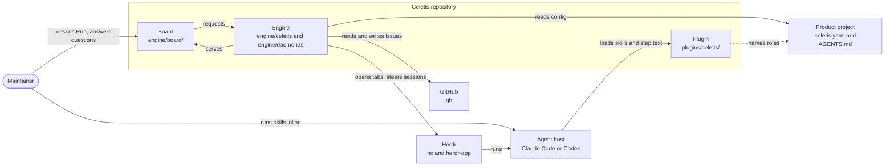

# About Celetis

This document explains what Celetis is, which parts it has, and where each part lives in the
repository. Each part has its own document, which the sections below link.

## The problem

Celetis is a software factory harness: the process and the runtime around coding agents that take
each change of a product through its lifecycle. The aim is intent to release. Today a change goes
from intent to the trunk, and each product project does its own release
([the constitution](../../CONSTITUTION.md)).

Celetis serves the maintainers of the product projects that use it. Each maintainer owns the
adoption and the wiring of a project. The maintainer of this repository is one of them, because this
repository is a product project of its own plugin.

The main idea is that one GitHub issue carries one change. The issue holds the intent, the lane, the
spec, the plan, the build, and the landing. Each result of a step goes onto the issue, and each
hand-off reads the issue again ([the plugin README](../../plugins/celetis/README.md)). ADR-0036 keeps
GitHub as the state store and excludes a workflow database and a local state store
([ADR-0036](../../docs/adr/0036-the-engine-enforces-the-lifecycle-and-the-landing.md)).

A lane is one type of change: `bug`, `feature`, `chore`, or `hotfix`. Each lane has steps in a fixed
order. A daemon run starts each step in an agent session of its own. A gate says who starts a step:
a person presses Run (`manual`), or the daemon starts it in auto mode (`auto`) ([the product
document](../../PRODUCT.md)).

Before ADR-0036, the rules that protect a landing were prompt text only, and no code checked them.
So the engine now enforces the lifecycle and the landing, and the skills
call engine commands for each write that the engine reads. The next document,
[About the lifecycle of a change](change-lifecycle.md), follows one change through the lanes.

Celetis fits different types of product. The plugin names roles, for example "the verify gate of the
project", and each product project names its own parts in its `.celetis.yaml` and its `AGENTS.md`
([the constitution](../../CONSTITUTION.md)).

## The codemap

Celetis has two modules, and one repository holds both. The plugin gives the skills and the
instructions that a person or an agent uses inline in a session. The engine runs the phases of the
lifecycle as autonomous workflows, and it serves the board. A host (Claude Code or Codex) loads the
plugin. The engine runs the hosts.

### The plugin

The plugin is the folder `plugins/celetis/`. It holds the agent text, in four layers
([`AGENTS.md`](../../AGENTS.md), "Where agent text lives"):

- `plugins/celetis/skills/<name>/SKILL.md` holds one skill each, for example the lane skills
  `intake`, `triage`, `feature`, `bug`, `chore`, and `hotfix`, and the step skills `specify`, `plan`,
  and `implement`.
- `plugins/celetis/references/procedures/` holds the procedure modules that more than one caller
  loads. `entry.md` there gives the entry of each skill.
- `plugins/celetis/references/principles/` holds one canonical file for each general engineering
  rule.
- `plugins/celetis/step-prompt.md` holds the step text of a run.

The plugin also holds the entry hook (`plugins/celetis/hooks/hooks.json` and the built
`plugins/celetis/hooks/entry.js`), the manifests of the two hosts
(`plugins/celetis/.claude-plugin/plugin.json` and `plugins/celetis/.codex-plugin/plugin.json`),
`plugins/celetis/contract.json`, and the documents that people read (`plugins/celetis/docs/`). The
root file `.claude-plugin/marketplace.json` names the folder `./plugins/celetis` as the source of the
plugin.

[About the skills and the agent text](agent-text.md) explains the layers and the placement rule. The
skills table is in [the plugin README](../../plugins/celetis/README.md#the-skills).

### The engine

The engine is the folder `engine/`. Its entry is `engine/celetis`, which `scripts/build.ts`
generates. Each command of Celetis has one file `engine/<command>.ts`, for example `engine/daemon.ts`,
`engine/run.ts`, `engine/land.ts`, `engine/issue.ts`, and `engine/next-step.ts`. The commands
call libraries in `engine/lib/`, which holds only feature folders. These are the main ones:

| Folder | Holds |
| --- | --- |
| `engine/lib/workflow/` | `workflow.ts`, the one definition of the workflow: the lanes, the steps, the stages, the gates, and the skip rule. A product project cannot change it. |
| `engine/lib/resolver/` | `resolver.ts`, which decides the next step of an issue (`nextIssue`, `nextOpen`). |
| `engine/lib/tracker/` | `tracker.ts`, the tracker port: the reads and writes of an issue, their types, and the error `TrackerError`. |
| `engine/lib/code-host/` | `code-host.ts`, the code-host port: the repository, the PRs, the checks, and the error `CodeHostError`. |
| `engine/lib/github/` | The GitHub adapter, the one place that runs `gh` for GitHub data: the client `github.ts` and the adapters of the two ports. |
| `engine/lib/services/` | `services.ts`, which makes the two ports over one GitHub client. |
| `engine/lib/landing/` | The landing of a change on the trunk. |
| `engine/lib/daemon/` | The server, the client, and the landing of the master daemon. |
| `engine/lib/run/` | The run machine of the daemon: `engine.ts`, `machine.ts`, and `activities.ts`. |
| `engine/lib/host/` | `hosts.ts` and one adapter for each host (`claude/adapter.ts`, `codex/adapter.ts`, `opencode/adapter.ts`). |
| `engine/lib/terminal/` | `terminal.ts`, which calls `hc` and `herdr-app` to open and steer the session tabs. |
| `engine/lib/state/` | The locks, the event record, and the other state that the engine keeps. |
| `engine/lib/queue/` | The continuous queue. |
| `engine/lib/contract/` | `contract.ts`, the declaration of the commands and the exit classes. |
| `engine/lib/config/` | The reader of `.celetis.yaml`. |
| `engine/lib/install/` and `engine/lib/update/` | The install and the update of the engine and the plugins. |

The master daemon is one long-lived process for one repository. It starts as `engine/daemon.ts
--daemon`. It runs many issue runs at the same time, runs each landing, and serves requests on a
Unix socket. The commands `run`, `queue`, and `land` are its clients. With no daemon, `land` runs the
landing in its own process. A run opens each session in a
tab of the Herdr app, and the daemon ends the session when its step is done
([the engine document](../../engine/README.md#the-master-daemon)).
[About the daemon and its runs](daemon-and-runs.md) explains how a run works.

### The board

The board is the folder `engine/board/`. It is a local web page for one repository. It shows each
live agent session and each issue of the flow, and it starts a step with one press. The master
daemon serves it in its own process. Its server modules include `start.ts`, `perimeter.ts`,
`requests.ts`, `reads.ts`, `place.ts`, and `presses.ts`, and its fixed adapter is `adapter.ts`. The
page modules are in `engine/board/page/`. The board reads engine state through
`engine/lib/board-read/board-read.ts`. The files `engine/board/board.js` and `engine/board/theme.js`
are generated from the page sources ([the board document](../../engine/board/README.md);
[the product document](../../PRODUCT.md)). [About the board](board.md) explains its design.

### The scripts

The folder `scripts/` holds the maintenance programs of this repository: `scripts/verify.ts` (the
verify gate), `scripts/build.ts`, `scripts/install-tools.ts`, and `scripts/herdr-lab.ts`
([the scripts document](../../scripts/README.md)).

### The documentation site

The folder `website/` holds a Docusaurus site that publishes the documents of the homes under
`docs/` as a public website, `https://ddinkov10.github.io/celetis/`. The site reads the documents in
place, so a document needs no header and no change, and a new document in a published home shows
with no edit of the site. A link from a document to a file outside the published homes, for example
an ADR or `AGENTS.md`, opens that file on GitHub. The workflow `.github/workflows/docs.yml` builds
the site and deploys it to GitHub Pages on each push to `main`; it needs a public repository or a
plan with Pages, and the maintainer sets **Pages → Source** to **GitHub Actions** once. The skill
`docs-site` writes the same files into a product project. The verify gate installs no package of
the site and builds nothing of it, so a document with a broken link lands, and its deploy fails
after the landing. The failure shows only in GitHub Actions
([ADR-0122](../../docs/adr/0122-the-documents-of-a-product-are-a-website-on-github-pages.md)).

### The records

The records are `docs/adr/` (the decision records, with the generated index `docs/adr/index.md`) and
`.celetis/lessons/` (the lesson store that the engine manages). `CONSTITUTION.md` is a file with a
fixed path in a product project
([ADR-0105](../../docs/adr/0105-a-product-project-has-one-constitution-at-a-fixed-path.md)). The
folder `docs/hosts/` holds the host documents. [About the records](records.md) explains what each
record is for.

### The product project

A product project is any repository that uses the plugin. It holds only what is its own:
`.celetis.yaml`, `AGENTS.md`, `docs/adr/`, `.celetis/lessons/`, `CONSTITUTION.md`, and the host
wiring that `/celetis:setup` writes. It holds no launcher, no runtime source, no skill, and no
document of the harness ([the plugin README](../../plugins/celetis/README.md)). This repository is
also such a project.

## The invariants

These rules hold in each part.

- The GitHub issue is the one state store. No step keeps state that the next step cannot read from
  the issue ([the product document](../../PRODUCT.md)).
- The plugin names roles, never a part of a product. A product project names its own parts
  ([`AGENTS.md`](../../AGENTS.md), "General text"). The plugin folder holds no TypeScript file. The
  TypeScript source stays in `engine/` and `scripts/`, and the config of the site stays in `website/`.
- One workflow definition exists, in `engine/lib/workflow/workflow.ts`
  ([the workflow document](../../plugins/celetis/docs/workflow.md)).
- An agent lands a change only through `celetis --agent <host> land`, and only when the checks of
  the project pass on the tip that lands. The landing checks the exact tip that it lands
  ([the constitution](../../CONSTITUTION.md)).
- No agent approves an update of a real installation. A person confirms the exact target, in a
  terminal or with a direct click on the board. An agent must not approve a change to a live
  installation on behalf of a person ([the constitution](../../CONSTITUTION.md)).
- One master daemon runs the work of one repository. An issue has one lock owner at a time, because
  the locks are shared Git refs ([the engine document](../../engine/README.md#the-start-of-a-step)).
- A stop of the daemon does not end a released session. The released sessions stay in their tabs,
  and the next daemon takes them over
  ([ADR-0072](../../docs/adr/0072-one-master-daemon-runs-every-issue-run.md)).
- No library module imports a command file. Each GitHub call of the engine goes through the tracker
  port or the code-host port; only the History read of `board-read.ts` uses the GitHub client
  directly. The read side of the board reads engine state through `board-read.ts`.
  `checkImports` in `scripts/verify.ts` checks the command-file rule and the read side of the
  board ([ADR-0081](../../docs/adr/0081-the-resolver-and-the-updater-are-libraries-and-no-library-imports-a-command.md),
  [ADR-0082](../../docs/adr/0082-every-github-call-goes-through-the-tracker-port.md),
  [ADR-0087](../../docs/adr/0087-the-board-reads-engine-state-through-one-read-model.md)).
- A command file keeps its name. The lock check accepts a daemon only when its process command line
  contains `daemon.ts`, so a rename makes a live owner look stale
  ([`AGENTS.md`](../../AGENTS.md), "Traps").
- On the board, no card moves by hand, and the board starts no step by itself. The issue and the
  daemon stay the authority ([the product document](../../PRODUCT.md)).
- The repository keeps no test file. The verify gate is its only check
  ([ADR-0029](../../docs/adr/0029-the-repository-keeps-no-tests.md)).

## The boundaries

**The plugin and the engine.** The two modules reach a machine in two deliveries of one repository.
A host installs the plugin from its marketplace. A person installs the engine one time on each
machine with `celetis install`, and `celetis update` then updates the engine and each host plugin
with one confirmation
([ADR-0042](../../docs/adr/0042-one-celetis-program-for-both-hosts.md)). The host copies only the
folder of the catalog source, so the root catalog names `plugins/celetis/`, and a plugin install
copies no engine
([ADR-0085](../../docs/adr/0085-the-plugin-lives-in-plugins-celetis.md)). The line between them is
the contract version. The plugin declares the version that it needs in
`plugins/celetis/contract.json`. The engine declares the versions that it serves in
`engine/lib/contract/versions.json`. Before each new step session, the daemon calls
`requireContract` of `engine/lib/contract/check.ts`, so the skills, the step text, and the engine of
a session share one contract version ([the engine document](../../engine/README.md#the-engine-and-the-plugin)).
What crosses the line: the commands that skills call, in the forms that `engine/lib/contract/contract.ts`
declares.

**The engine and GitHub.** The engine logs in through `gh`. The GitHub adapter in
`engine/lib/github/` is the one place that runs `gh` for GitHub data. It parses each response into
a domain type before a caller sees it. A caller uses the tracker port or the code-host port, and
catches the error of that port: `TrackerError` or `CodeHostError`
([ADR-0082](../../docs/adr/0082-every-github-call-goes-through-the-tracker-port.md)). A step session
writes to an issue through the command `issue` (`engine/issue.ts`), which checks the prerequisite of
each act against the history of the issue before it writes
([ADR-0036](../../docs/adr/0036-the-engine-enforces-the-lifecycle-and-the-landing.md)).

**The engine and the session terminals.** `engine/lib/terminal/terminal.ts` owns each call to `hc`
(herdr-core) and `herdr-app`. herdr-core gives the status and the turn of a session, and the Herdr
app gives the tabs. Each session runs in a tab of its own that the daemon steers from outside
([ADR-0058](../../docs/adr/0058-herdr-core-hosts-the-agent-terminals.md)).

**The engine and the host CLIs.** One adapter for each host holds the host differences. Before the
adapters, each module asked for the host itself, and a change of a host CLI needed a search for each
branch ([ADR-0088](../../docs/adr/0088-one-adapter-for-each-host-holds-the-host-differences.md)). An
adapter also states what its host can run: OpenCode runs only the step `triage`
([the engine document](../../engine/README.md#the-start-of-a-step)).

**The daemon and its clients.** The commands `run`, `queue`, and `land` send one request each to the
daemon on a Unix socket in a folder that only the current user can open. The daemon uses no token.
The board gives its requests to the same dispatcher in the process of the daemon, with no socket
([the engine document](../../engine/README.md#the-master-daemon)). The board page itself loads
nothing from the network, and its trust files keep the checks of each request
([the product document](../../PRODUCT.md)).

**The plugin and the product project.** The plugin names a role, and the product project names the
thing. A product line has one of three homes: the `AGENTS.md` of the product, a custom
part `custom.<skill>` in `.celetis.yaml`, or no home when a permission rule or the verify gate
holds it already ([`AGENTS.md`](../../AGENTS.md), "General text").

**This repository and its adopters.** A change to Celetis can be designed, built, verified, and
landed with no product adopter. Each product maintainer owns adoption and wiring
([ADR-0031](../../docs/adr/0031-plugin-development-is-independent-of-adoption.md)).

## The cross-cutting concerns

**Configuration.** One `.celetis.yaml` at the root of the main checkout holds the setup of a
product project. The engine reads it from the main checkout, also for a command that starts in a
lane worktree. The fields are in
[the configuration document](../../plugins/celetis/docs/configuration.md#fields-and-defaults).
The daemon uses the environment of the shell that started it. A later change of that environment
does not reach a running daemon ([the engine document](../../engine/README.md#the-master-daemon)).

**Errors and exit codes.** `engine/lib/contract/contract.ts` is the one module that declares the
commands, their forms, and their exit classes. `scripts/build.ts` writes the command table and the
exit-class table of [the plugin README](../../plugins/celetis/README.md#the-commands) from it, and
`checkContract` in `scripts/verify.ts` checks the agent text against it
([ADR-0079](../../docs/adr/0079-one-contract-module-declares-the-commands-and-the-exit-classes.md)).

**Logs and events.** The daemon appends each line of its runs to
`<git common dir>/celetis/daemon/daemon.log`, and `celetis daemon status` shows each run with its last
line. Each Celetis process that detects a failure also appends one entry to a local event record,
which `celetis --agent <host> events` reads
([the workflow document](../../plugins/celetis/docs/workflow.md#start-the-script);
[the engine document](../../engine/README.md#the-event-record)).

**Checks.** The verify gate `scripts/verify.ts` is the only check of this repository, and CI runs it
([the scripts document](../../scripts/README.md#the-verify-gate)). Besides the type, format, and
plugin checks, it checks the citations and links of the agent text, the contract, the import rules,
the contract version, and the layout of `engine/lib/`
([`AGENTS.md`](../../AGENTS.md), "Verify gate" and "The engine layout"). A check that needs the Herdr
app or the hc core runs in a lab of `scripts/herdr-lab.ts`, away from the window of the maintainer
([`AGENTS.md`](../../AGENTS.md), "Host checks").

**Generated files.** `scripts/build.ts` writes the engine entry, the browser bundles, the native
hook module, the generated blocks of two plugin documents, and `docs/adr/index.md`. A product project
runs no build ([the scripts document](../../scripts/README.md#the-build)).

**Layout of the engine.** `engine/lib/` holds only feature folders, each named by a noun of the
engine. The head file of a folder has the name of the folder, and no `index.ts` exists
([ADR-0114](../../docs/adr/0114-the-engine-library-groups-its-files-into-feature-folders.md)).

**Platforms.** The daemon runs on macOS, Linux, and native Windows. The hosts of the plugin are
Claude Code and Codex ([the plugin README](../../plugins/celetis/README.md#requirements)). The
engine also has an adapter for OpenCode, which runs only the step `triage`
([the engine document](../../engine/README.md#the-start-of-a-step)).

**Language.** The text of the project uses plain, literal, short sentences in the style of
ASD-STE100 Simplified Technical English ([the product document](../../PRODUCT.md)).
