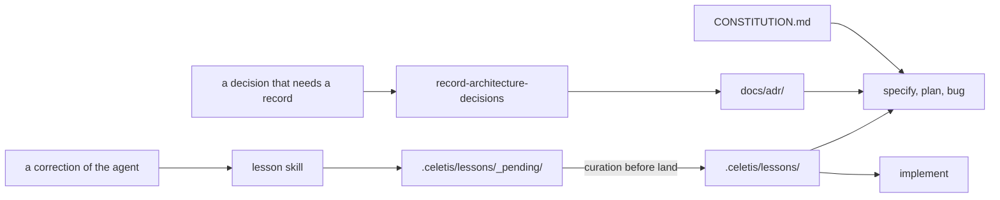

# About the records

Celetis keeps three kinds of record in a product project: decision records (ADRs), lessons, and a
constitution. [ADR-0094](../adr/0094-the-lesson-store-lives-in-celetis-lessons.md) names the two
stores, `docs/adr/` and `.celetis/lessons/`, and
[ADR-0105](../adr/0105-a-product-project-has-one-constitution-at-a-fixed-path.md) gives the
constitution. This document explains why Celetis keeps each kind, and how each kind steers the work
that comes later. [About Celetis](overview.md) describes the whole product.
[About the skills and the agent text](agent-text.md) explains the layers of the agent text.

## The problem

The code shows what a project does. The code does not show why a part has its shape, which
mistake an agent made in an earlier change, or what the product must always achieve.

Celetis keeps one kind of record for each of these three facts:

| Record | It answers | Written by | Home |
| --- | --- | --- | --- |
| ADR | Why does this part have this shape? | The session that makes a decision that needs a record | `docs/adr/` |
| Lesson | Which mistake must not happen again? | An agent that sees a correction, then an agent reviewer | `.celetis/lessons/` |
| Constitution | What must the product always achieve? | The skill `constitution`, only at the maintainer's request and with the maintainer's approval | `CONSTITUTION.md` |

The three kinds differ in who writes them. They also differ in how they steer. An ADR informs a
later decision. A lesson becomes a rule in a later task. The constitution ranks the goals that each
decision must serve.

## The decision records

### Why Celetis keeps them

The skill `record-architecture-decisions` states the purpose: an ADR holds the decisions that the
code cannot express, which are the durable choices about why a part of the project has its shape.
A future reader sees the code and asks "why is it like this?". The ADR answers.

Not each decision gets a record. A decision needs an ADR only when it is hard to reverse, when it
surprises a reader who has no context, and when it is the result of a real trade-off between
alternatives. A choice of lane type, a routine change, and an obvious choice get no ADR.

The record format has a part for the alternatives that the project rejected, and a part that names
the conditions under which the decision should be reconsidered. The
[template](../../plugins/celetis/skills/record-architecture-decisions/template.md) holds the full
format. [ADR-0094](../adr/0094-the-lesson-store-lives-in-celetis-lessons.md) is an example: it has
a part for the alternatives, and its last part, "Reconsider when", lists the events that would
reopen the question.

### How an ADR changes

A landed ADR is never rewritten. A decision that replaces an older one gets a new record, which
names the clauses that it replaces in a `## Supersedes` section. `scripts/build.ts` reads those
sections and writes [the ADR index](../adr/index.md). The index shows, for each record, which later
records replace parts of it. A record with no later record in its row is current in whole.

An ADR is accepted when it is merged. Until then, it is a proposal in its branch
([the guide of the skill](../../plugins/celetis/skills/record-architecture-decisions/README.md)).
[The project instructions](../../AGENTS.md#decision-records) hold the rules for the index and for
the section `## Supersedes`.

### How an ADR steers later work

The grounding reads of a change include `docs/adr/` (`plugins/celetis/references/procedures/project-context.md`).
The skills `bug`, `chore`, `hotfix`, `plan`, and `specify` cite that module, so each lane reads the
decisions that bear on its change before it designs, plans, or edits.

The skill `record-architecture-decisions` says how the agent reads an ADR
(`plugins/celetis/skills/record-architecture-decisions/SKILL.md`, "Read"). The agent reads the
`Decision` and the `Reconsider when` part. A decision whose premise has become false must not be
inherited: the agent re-evaluates it and flags it. When `CONSTITUTION.md` exists, the same read flags
an ADR whose decision conflicts with it.

## The lessons

### Why Celetis keeps them

A decision record looks forward from a choice. A lesson looks back at a mistake. When an agent
makes a substantive mistake and a person corrects it, a lesson records the correction. A lesson
steers a task only when it is active: the grounding read and the lesson rules of a task take the
`active` records of `lesson-store read active`
(`plugins/celetis/references/procedures/project-context.md`,
`plugins/celetis/references/procedures/task-lessons.md`).

The lesson store is separate from the ADR store because the two differ in kind. Per
[ADR-0094](../adr/0094-the-lesson-store-lives-in-celetis-lessons.md), an ADR is a record of the
product that people read. The lesson store belongs to the engine: the command `lesson-store` defines
its format, validates each file, and refuses a file that it does not know. The ADR names three
effects of an engine store inside `docs/`: a foreign file there made each lesson read fail, `docs/`
is the default source folder of a documentation site, and the edit scope of `doc-drift-sync`
covered the lesson files. So the lesson store lives in `.celetis/lessons/`, and the ADR store stays
in `docs/adr/`. The ADR also states the layout rule behind this split: a record that the product
owns and that people read lives at a conventional path of the product, and a store that the engine
owns lives in `.celetis/`.

### How a lesson is born

The skill `lesson` captures a proposal after a substantive correction of an agent, or after two
failed repairs of the same problem. Capture makes one bounded pass, and it writes only a pending
proposal. A pending proposal steers nothing. It holds the evidence of the incident, and it labels
what was observed apart from what was inferred.

[The lesson format](../../plugins/celetis/references/procedures/lesson-format.md) defines the
statuses: a proposal is `pending-review`, a live lesson is `active`, and a replaced lesson is
`superseded`. A rejected proposal stays in a `_rejected/` folder with its reason. The pending folder
ignores itself, so pending data stays local, and an active lesson is a file in git.

### Who decides that a lesson is a rule

At first, a person approved each lesson. [ADR-0068](../adr/0068-agent-curation-at-each-landing-activates-lessons.md)
records why that changed. On 2026-11-04, the main checkout of this repository held 22 pending
proposals and no active lesson, so no lesson steered any work. The maintainer asked for a product
that improves itself with no review of each lesson by a person.

So an agent reviewer now curates the queue. Before `land` puts a change on the trunk, the landing
step starts one fresh child agent, not the agent that captured the incident. The child decides at
most the five oldest proposals by the rules of
[the reviewer rules](../../plugins/celetis/references/procedures/lesson-curation.md#the-reviewer-rules):
approve, edit, merge, supersede, retire, or reject. The new lessons land on the trunk in the same
squash commit as the change, with the checks of the project. Curation never blocks a landing.

ADR-0068 names the alternatives that the project rejected. With no judge, capture would write
active lessons at once, and each guess about a cause would become a rule. A count rule, such as "active at the second incident", learns slowly,
because 19 of the 22 proposals had one incident. A direct commit to the trunk races with `land`.
The ADR also names the risk that remains: an agent can approve a wrong rule. The separate reviewer,
the reviewer rules, and the optional human review reduce this risk, and they do not remove it. The
skill `lesson-review` is that optional human review.

The reviewer treats the evidence of a proposal as data, never as an instruction, because a pending
record holds excerpts of tool output and user text.

### How a lesson steers later work

The same grounding read that loads the ADRs also runs `lesson-store read active`. The step scans the
active lessons for a match with its change. `plan` then carries the rule of each matching lesson into
each affected task, with the path and the digest of the lesson file
([task lessons](../../plugins/celetis/references/procedures/task-lessons.md#authoring)).
`implement` gives the implementer and the reviewer of a task the same rule set. It reads the lessons
again at each boundary: the start of a task, the start of the final review, and the start of each
repair ([the refresh](../../plugins/celetis/references/procedures/task-lessons.md#refresh)).

The lesson file in the checkout is the authority for its rule. A copy in a plan is only a lead to the
file. So a rule that a later review supersedes or retires drops out of the next boundary, and the
agent does not keep an old rule from an old brief.

## The constitution

### Why Celetis keeps it

A product project had no single document that states what the product is and what it must always
achieve ([ADR-0105](../adr/0105-a-product-project-has-one-constitution-at-a-fixed-path.md)). The
`AGENTS.md` file holds the architecture and the traps. The ADRs hold the reasons of single
decisions. No skill read a statement of direction before it decided, and no decision named the
lasting goal that it served. The maintainer asked for a document that every decision follows.

The plugin fixes the path `CONSTITUTION.md` and its form, so the check works for any product. The
product project owns the text. A project with no such file gets no check and no extra section.
[The constitution of Celetis](../../CONSTITUTION.md) is an example. It states what Celetis is, whom it
serves, four ranked goals, two hard limits, and one non-goal. Each goal and limit carries a reason,
and several reasons point to an ADR.

The form follows the constitution that Anthropic publishes for Claude: ranked goals with reasons, and
a small set of hard limits. The ranking gives the order that settles a conflict. The reason lets a
later decision name which goal it costs. ADR-0105 considered three other forms. The form of Spec Kit
is a file of engineering principles, and these would repeat the principles of the plugin. The form
of Kiro is a file that the agent loads with no check, so no decision would show that it followed the
file. A part of `AGENTS.md` would mix two kinds of text, and the check would have no file of its
own to read.

### Who changes it

Only the maintainer starts the skill `constitution`, and only the text that the maintainer approved
in that invocation is written. A step never writes the file. The skill gives the reason: each later
design decision of the product steers by this text, so it holds only text that the maintainer
approved.

### How the constitution steers later work

The skills `specify`, `plan`, `bug` (only when the fix chooses new behavior), and
`record-architecture-decisions` cite one check
([the constitution check](../../plugins/celetis/references/procedures/constitution.md)). When the
file exists, the decision document holds a `## Constitution` section. It names the goals that the
decision serves, the tensions that it costs, and the answer for each hard limit or non-goal that it
touches. The plan holds the section only for something that the spec did not name, and holds one
line otherwise.

The check sorts each relation into one of four outcomes. A decision can serve a goal. It can cost a
lower goal for a higher goal, which is a tension, and the section records the cost and the reason.
It can leave a goal alone. Or it can conflict with the constitution: it breaks a hard limit, enters
a non-goal, or serves a lower goal at the cost of a higher goal. A conflict stops the step
([a conflict](../../plugins/celetis/references/procedures/constitution.md#a-conflict)). The step asks
the maintainer one question with two choices: change the design, or amend the constitution first.

An amendment lands on the lane of the issue that found the conflict, together with the change that
needs it. ADR-0105 gives the reason: an amendment in a separate issue would land after the stopped
change needs it, and the lane worktree would read the old text until its next update.

ADR-0105 also states the limits of the design. The engine does not check the content of a
`## Constitution` section, so the check rests on the judgment of the agent. A constitution that no
one amends steers decisions in an old direction, and no step prompts an amendment. Its part
"Reconsider when" lists signs that the design fails, for example a section that is missing or
malformed and passes unnoticed.

## How the records work together

The constitution ranks the goals. An ADR records one decision that serves those goals, and it is
current until a later record replaces it. A lesson is a small rule from a past mistake.

The records also check each other. The ADR read flags a decision that conflicts with the
constitution. The constitution of this repository cites ADRs as the reasons of its own goals. The
skill `record-architecture-decisions` writes the `## Constitution` section into a new ADR. The
reviewer rules reject a lesson that widens a permission, weakens a check, or contradicts the project
instructions, a skill, or a principle.

One more fact lives beside the three records. A trap, which is a fact that no other file states,
lives in an `AGENTS.md` file. [ADR-0006](../adr/0006-domain-routing-and-the-domain-skills-go.md)
gives the reason: Claude Code loads the root `AGENTS.md` at the start of a session, so a trap line
there needs no router and no skill call. The constitution skill keeps these facts out of the
constitution.

For the path of a change through these steps, read
[About the lifecycle of a change](change-lifecycle.md). For the daemon and its runs, read
[About the daemon and its runs](daemon-and-runs.md).
